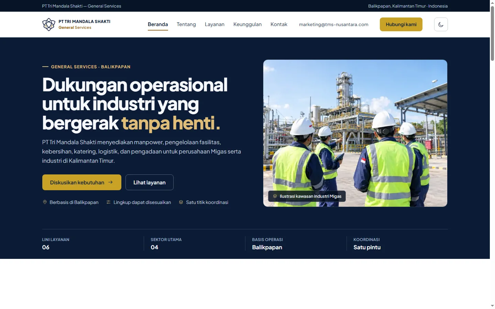
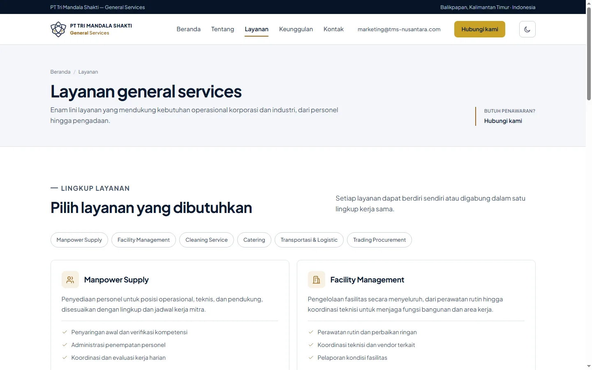
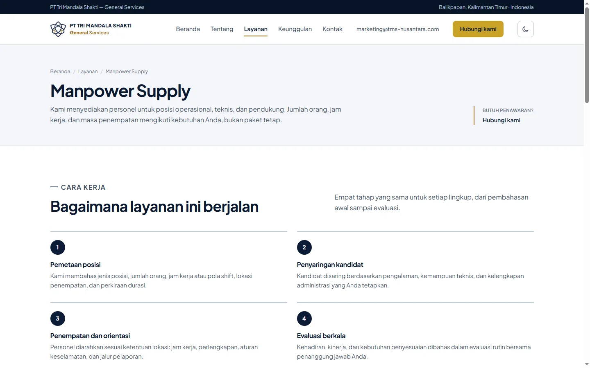
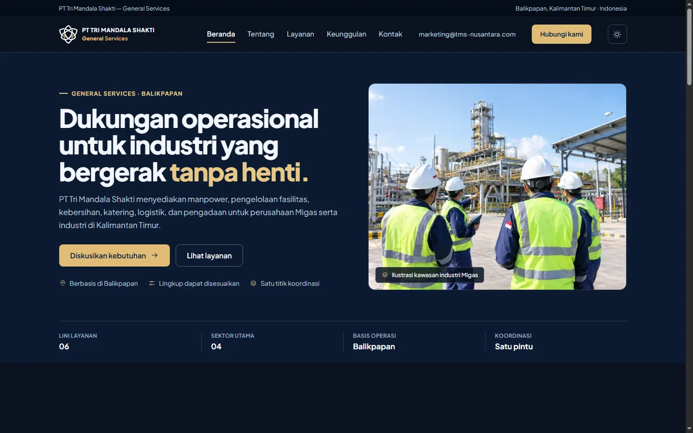
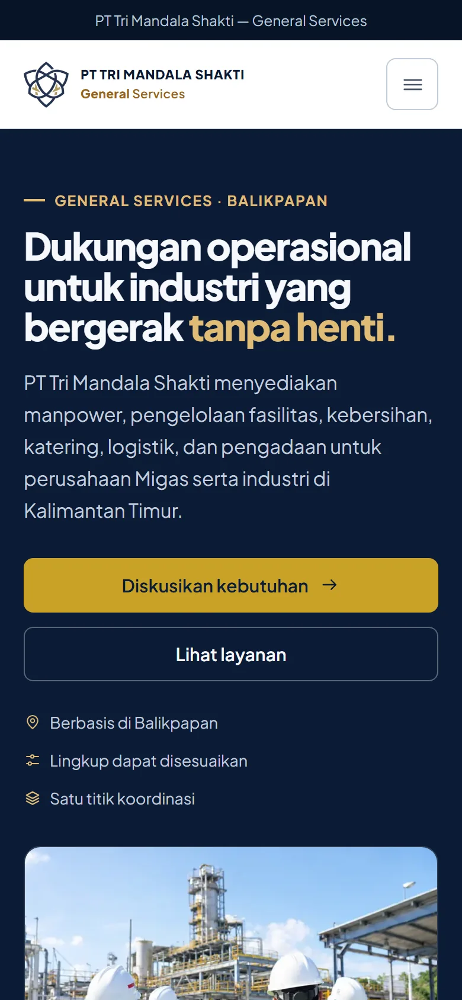
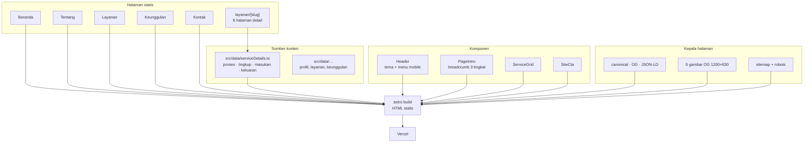

# Tri Mandala Shakti — Situs Profil Vendor General Services

**Situs profil perusahaan yang menjawab pertanyaan procurement sebelum mereka mengirim email.**

---

## Masalahnya

Vendor general services biasanya dikenali dari satu PDF company profile yang dikirim lewat email.
Orang procurement dan HRD tidak membacanya di meja kerja — mereka membukanya di HP, sambil
menunggu rapat, dan hanya ingin tahu tiga hal:

- Layanan apa saja yang benar-benar dikerjakan, bukan daftar kata kunci
- Di mana basis operasinya dan sektor apa yang dilayani
- Siapa yang bisa dihubungi kalau butuh penawaran

PDF tidak bisa di-scan dalam sepuluh detik, tidak punya pratinjau saat dibagikan di grup WhatsApp,
dan tidak memberi jalan masuk ke halaman yang menjelaskan satu layanan secara mendalam.

## Situsnya

Situs profil statis untuk **PT Tri Mandala Shakti General Services**, perusahaan jasa penunjang
operasional yang berbasis di Balikpapan dan melayani perusahaan Migas serta industri di Kalimantan
Timur.

Enam lini layanan — manpower supply, facility management, cleaning service, catering, transportasi
& logistik, trading procurement — masing-masing punya halaman sendiri yang menjelaskan cara kerja,
ruang lingkup, masukan yang dibutuhkan, dan keluaran yang diserahkan. Isinya sengaja dibatasi pada
proses, bukan klaim: tidak ada jumlah personel, sertifikasi, daftar klien, harga, atau SLA yang
dikarang.

### Yang ada di dalamnya

- **11 halaman statis + 404** — beranda, tentang, layanan, enam halaman detail layanan, keunggulan, kontak
- **Halaman detail per layanan** dari satu route dinamis `layanan/[slug]`, isinya dipisah ke `src/data/serviceDetails.ts` supaya menambah layanan tidak menyentuh template
- **Tema gelap dan terang tanpa kedip** — tema dibaca di `<head>` sebelum render, transisi 200 ms, dan tombol tema di header maupun menu mobile memakai aturan ikon yang sama
- **Pratinjau WhatsApp per layanan** — enam gambar OG 1200×630, jadi tautan ke halaman manpower tidak tampil sebagai gambar generik
- **Mobile-first** — diuji di 320, 360, 390, dan 414 px tanpa overflow; target sentuh ikon dan tautan 44 px
- **Animasi masuk judul section** — opacity dan geser 10 px, 420 ms, sekali jalan, seluruh state tersembunyi dibungkus `prefers-reduced-motion: no-preference`
- **SEO dasar yang lengkap** — canonical, sitemap, robots, JSON-LD `Organization` dan `Service`, breadcrumb tiga tingkat di halaman detail

---

## Tampilan

**Beranda** — posisi, sektor, dan enam lini layanan dalam satu layar pertama.

| Daftar layanan | Detail layanan |
| :---: | :---: |
|  |  |

**Tema gelap** — token warna terpisah, bukan filter.

**Di HP** — alur yang sama di 390px, karena pratinjau vendor sering dibuka dari tautan WhatsApp.

---

## Arsitektur

Keputusan yang penting:

- **Konten layanan di file data, bukan di komponen.** Satu objek per layanan memuat ringkasan,
  tahapan proses, ruang lingkup, dan catatan; route `layanan/[slug]` hanya merender. Menambah lini
  layanan berarti menambah data, bukan menduplikasi halaman.
- **Tanpa framework UI.** Seluruh interaksi (tombol tema, menu mobile, reveal) sekitar 100 baris
  JavaScript inline, jadi tidak ada hidrasi dan tidak ada bundel runtime.
- **Tema dibaca sebelum paint.** Skrip kecil di `<head>` menetapkan `data-theme` dari
  `localStorage` atau preferensi sistem, sehingga tidak ada kilatan putih saat halaman gelap dibuka.
- **OG image dibuat terpisah per layanan.** Enam gambar statis di `public/img/og/` dipetakan lewat
  prop `ogImagePath` di layout, bukan satu gambar generik untuk semua halaman.

---

## SEO dan pratinjau WhatsApp

- `sitemap-index.xml` berisi 11 URL, `robots.txt` dibuat saat build dari `SITE_URL`
- Canonical dan URL absolut OG mengikuti `SITE_URL`, bukan `localhost` atau `*.vercel.app`
- JSON-LD `Service` di setiap halaman detail, `Organization` di beranda
- Gambar OG 1200×630, teks besar, aman dipotong di pratinjau WhatsApp dan LinkedIn

---

## Kinerja

Diukur dengan Lighthouse pada build produksi, 11 halaman:

| Halaman | Performance | Accessibility | Best Practices | SEO | CLS |
| :--- | :---: | :---: | :---: | :---: | :---: |
| Beranda | 96–97 | 100 | 100 | 100 | 0 |
| Tentang | 100 | 100 | 100 | 100 | 0 |
| Layanan | 99–100 | 100 | 100 | 100 | 0 |
| Keunggulan | 100 | 100 | 100 | 100 | 0 |
| Kontak | 100 | 100 | 100 | 100 | 0 |
| Detail layanan | 99–100 | 100 | 100 | 100 | 0 |

Satu-satunya temuan yang sengaja dibiarkan: logo header dilayani pada 128 px untuk tampil 38 px.

---

## Stack

| Lapisan | Teknologi |
| :--- | :--- |
| Framework | Astro 7, output statis |
| Bahasa | TypeScript |
| Styling | CSS custom properties (dua set token tema) |
| Interaksi | JavaScript inline, tanpa framework UI |
| SEO | `@astrojs/sitemap`, JSON-LD, OG statis |
| Deploy | Vercel |

---

## Status

Situs ini **dibuat untuk klien** dan source code-nya disimpan privat. Repository ini adalah
showcase: dokumentasi produk, tampilan, arsitektur, dan hasil audit.

Situs **belum dibuka untuk publik** — domainnya belum diarahkan, jadi tidak ada tautan demo di sini.
Konten sengaja menahan diri dari klaim yang belum terverifikasi (jumlah personel, sertifikasi,
daftar klien, harga, SLA), dan setiap foto yang merupakan ilustrasi diberi label "ilustrasi" di
halaman.

Untuk pertanyaan atau diskusi teknis: buka issue di repository ini.

---

## English

**Tri Mandala Shakti** is a static company-profile site for a general-services contractor based in Balikpapan, Indonesia, serving oil and gas companies and industry across East Kalimantan.

Six service lines each get their own page explaining how the work runs, what scope it covers, what input is needed, and what gets delivered. Content is limited to process rather than claims: no headcount, certifications, client list, prices, or SLAs are invented.

The build is plain Astro with static output: 11 pages plus a 404, a theme that resolves before paint, per-service 1200×630 Open Graph images, JSON-LD for `Organization` and `Service`, and Lighthouse scores of 96–100 with zero layout shift. The source code is not published; this repository documents the product.

---

## Lisensi

**All Rights Reserved.** Copyright © 2026 Kandar Lubis.

Kode sumber tidak dipublikasikan dan tidak dilisensikan untuk digunakan ulang. Dokumentasi ini
disajikan untuk peninjauan dan evaluasi.
